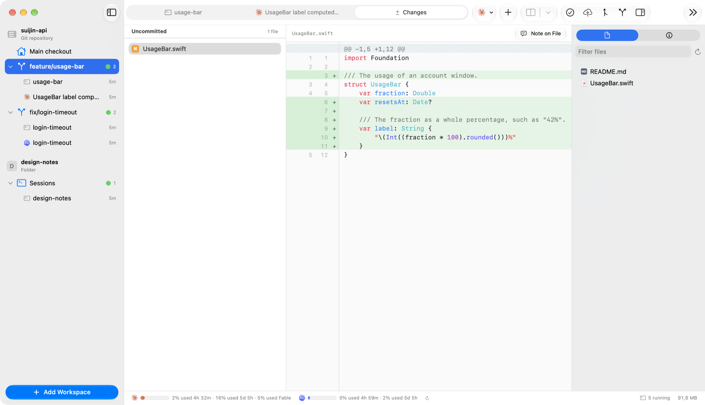
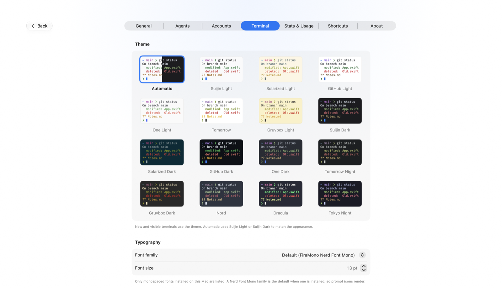
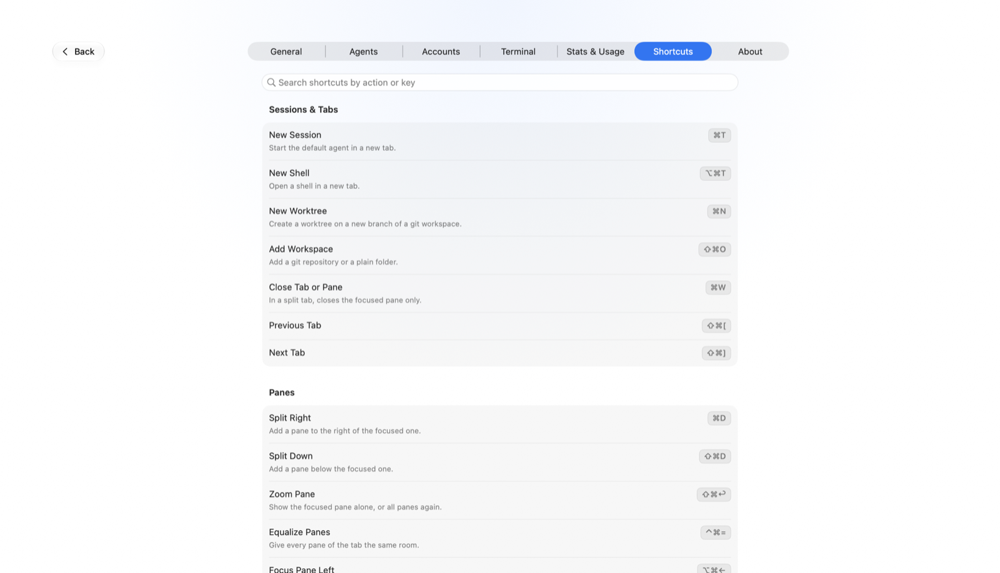

# Suijin

> **Draft.** This README is a first pass and will change before the first release.

Suijin (水神) is a native macOS app that runs Claude Code and Codex agents side by side. Each agent works in a git
worktree of its own (or straight in a plain folder), so their changes never collide, and you review and ship what they
did without leaving the app. Everything runs locally on your Mac: no servers, no remote hosts, no cloud.

Website: [suijin.app](https://suijin.app)


## Status

Suijin is at `0.1.0 (unreleased)`. There is no signed download yet; for now you build it from source (see
[Build from source](#build-from-source)). In-app updates are built in but turned off until the update feed exists.

## Features

### Workspaces and worktrees

- Add a git repository or a plain folder as a workspace (⇧⌘O).
- Create a worktree on a new branch (⌘N). Each agent gets a branch and a folder of its own.
- The sidebar shows every workspace, its worktrees and the status of each session running in them.
- A folder workspace has no worktrees or diffs; agents run straight in it.

### Sessions, tabs and split panes

- Start Claude Code, Codex or a plain shell in a tab (⌘T for the default agent, ⌥⌘T for a shell).
- Split a tab to the right or down (⌘D, ⇧⌘D) and run two to ten sessions as panes in one tab.
- Drag tabs to reorder them. Drag a pane's header onto an edge to place it there, or onto the center to swap.
- Move focus between panes (⌥⌘←→) or zoom the focused one (⇧⌘↩).
- Sessions run in a background helper, so quitting or updating Suijin does not stop your agents. Closing a tab ends
  its session.
- When an agent exits, its tab shows a Session Ended view with **Resume Session** and **Start Again**.
- Clicking a file path in terminal output opens that file.

### Changes, diff and pull requests



- Review every change in a native diff viewer with syntax highlighting, including image previews.
- Leave notes on a file or a line and send them to an agent.
- Commit, push and create a pull request from the same tab (⌘↩).
- Browse the worktree's files in the inspector (⌥⌘I) and open them in a viewer tab.

### Permission modes

Every agent session starts in a permission mode: Ask, Auto-Accept Edits, Plan or Skip All Permissions for Claude Code;
Ask, Auto, Read-Only or Skip All Permissions for Codex. Settings sets the default per agent, and the Permissions menu
picks one for a single session. A session that skips permission checks shows a warning badge, and starting one is
confirmed first.

### Multiple accounts

- Add several managed Claude and Codex accounts and choose which one a session uses.
- Your own logins stay untouched: Suijin never writes to `~/.claude`, `~/.claude.json`, `~/.codex` or the default
  Claude Code Keychain item. Managed accounts live under `~/Library/Application Support/Suijin`.
- The status bar shows each plan's usage.
- **Continue With Another Account** carries a conversation to another account when one runs out, in the same tab,
  folder and permission mode.
- Optional automatic switching moves a session to the next account with room when its account hits a limit.

### Agent orchestration

An agent in a Suijin terminal can start worker agents with the bundled `suijin` command, message them and collect
their results. The sidebar shows workers under the session that started them.

### Stats and usage

Settings › Stats & Usage shows tokens, estimated cost and activity per day, read from the local Claude Code and Codex
logs (read-only). Costs are estimates at API list prices, not your subscription bill. Clicking the session count in
the status bar opens the Resource Manager with the memory and CPU of running sessions.

## Settings

Open Settings with ⌘,. It has seven pages.

| Page | What it controls |
|---|---|
| General | Appearance (Automatic, Light, Dark), notifications when an agent waits for input or finishes, keeping sessions running after quitting, update checks, the welcome tour |
| Agents | Default agent, what a new pane runs, the folder for new worktrees, default permission mode per agent, where `claude` and `codex` were found, Codex daemon option, orchestration |
| Accounts | Managed Claude and Codex accounts, the default account per provider, automatic account switching |
| Terminal | Theme (15 built in, or Automatic to follow the appearance), font family and size, how file paths open |
| Stats & Usage | Token usage, estimated cost and activity for 7 days, 30 days or all time |
| Shortcuts | Every keyboard shortcut and mouse gesture, searchable by action or key (also Help › Keyboard Shortcuts, ⌘/) |
| About | Version, legal documents |






## First launch


A short tour introduces workspaces, sessions, changes and accounts. It shows once and can be reopened from
Settings › General.

Suijin needs `claude` and/or `codex` installed and on the `PATH` of your login shell; Settings › Agents shows what it
found.

## Requirements

- macOS 15 or later. The Liquid Glass interface needs macOS 26 or later.
- To build: Xcode 27, `xcodegen` (`brew install xcodegen`) and the Metal Toolchain for SwiftTerm's renderer
  (`xcodebuild -downloadComponent metalToolchain`).

## Build from source

```sh
scripts/bootstrap.sh            # generate Suijin.xcodeproj from project.yml
scripts/ci-local.sh             # package tests + app build and tests
open Suijin.xcodeproj
```

The first time you build in Xcode, it stops with "Plugin “SwiftTermBuildInfoPlugin” from package “SwiftTerm” must be
enabled". Click the error and choose **Trust & Enable**. SwiftTerm ships this build-tool plugin, and Xcode asks once per
machine and again after a SwiftTerm upgrade. Command-line builds skip the prompt with `-skipPackagePluginValidation`.

## Documentation

- [`CLAUDE.md`](CLAUDE.md): repository rules for people and AI agents.
- [`docs/architecture.md`](docs/architecture.md): package layout, processes, sessions, accounts and tests.
- [`docs/release-process.md`](docs/release-process.md): signing, notarization and Sparkle updates.
- [`CHANGELOG.md`](CHANGELOG.md): what changed.
