# Suijin

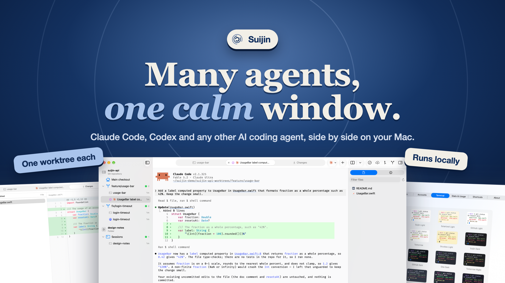

Suijin is a native macOS app that runs Claude Code, Codex and any other AI coding agent at the same time, side by
side. Each agent works in a git worktree of its own (or straight in a plain folder), so their changes never collide,
and you review and ship what they did without leaving the app. Your code and your agents stay on your Mac: no remote
hosts, no cloud. Suijin itself goes online only to check for updates.

Claude Code and Codex are built in: Suijin shows their status, manages their accounts and permission modes, and lets
them hand work to each other. Any other agent that runs in a terminal (Gemini CLI, Aider, OpenCode and the like) runs
in a shell tab or pane next to them.

Website: [suijin.app](https://suijin.app) · Community: [Discord](https://discord.gg/Hz8UBEKxuT)

[](https://ko-fi.com/vovanvu)

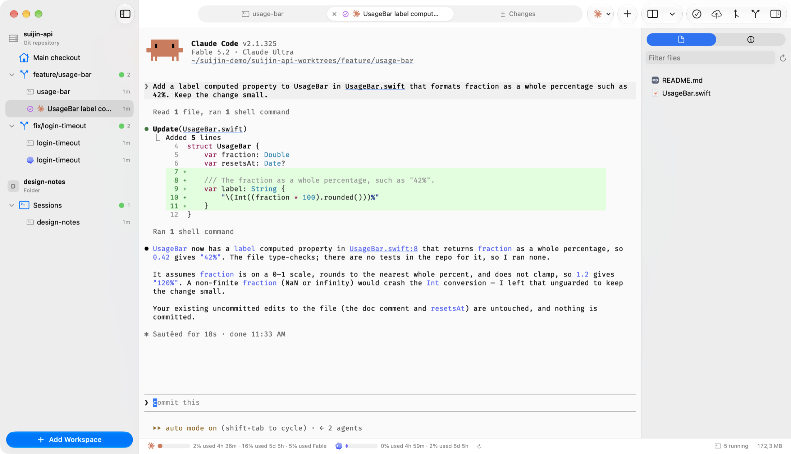

## Status

Suijin `0.1.0` is the first release. Download the signed and notarized DMG from the
[latest release](https://github.com/Suijin-App/Suijin/releases/latest); installed copies check for new versions
themselves. You can also build it from source (see [Build from source](#build-from-source)).

## Features

### Workspaces and worktrees

- Add a git repository or a plain folder as a workspace (⇧⌘O).
- Create a worktree on a new branch (⌘N). Each agent gets a branch and a folder of its own.
- The sidebar shows every workspace, its worktrees and the status of each session running in them.
- A folder workspace has no worktrees or diffs; agents run straight in it.

### Sessions, tabs and split panes

- Start Claude Code, Codex or a plain shell in a tab (⌘T for the default agent, ⌥⌘T for a shell).
- A shell runs any other command-line agent. It gets a tab or pane, a worktree and a place in split layouts like the
  built-in agents; the status badges, accounts, permission modes and orchestration are for Claude Code and Codex.
- Split a tab to the right or down (⌘D, ⇧⌘D) and run two to ten sessions as panes in one tab.
- Drag tabs to reorder them. Drag a pane's header onto an edge to place it there, or onto the center to swap.
- Move focus between panes (⌥⌘←→) or zoom the focused one (⇧⌘↩).
- Sessions run in a background helper, so quitting or updating Suijin does not stop your agents. Closing a tab ends
  its session.
- When an agent exits, its tab shows a Session Ended view with **Resume Session** and **Start Again**.

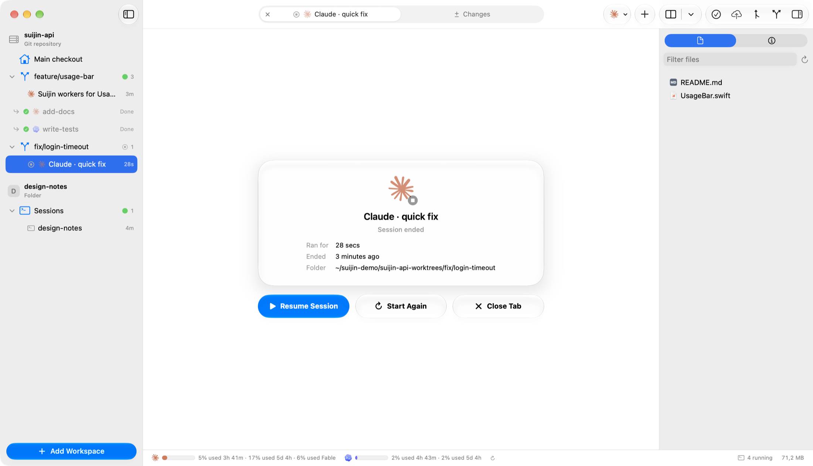

- Clicking a file path in terminal output opens that file.

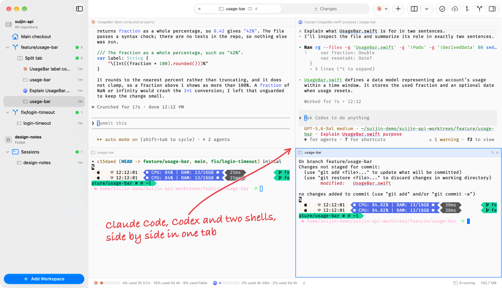

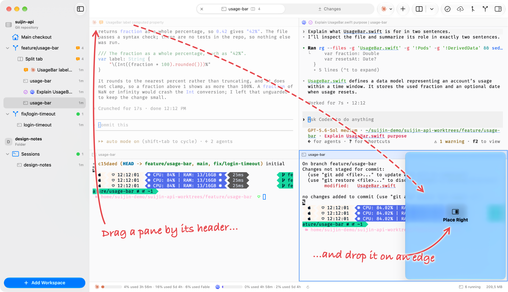

### Changes, diff and pull requests


- Review every change in a native diff viewer with syntax highlighting, including image previews.
- Leave notes on a file or a line and send them to an agent.
- Commit, push and create a pull request from the same tab (⌘↩).
- Browse the worktree's files in the inspector (⌥⌘I) and open them in a viewer tab.

### Files and media

Files open in a tab next to your sessions: code with syntax highlighting, Markdown rendered, images with zoom and pan,
and video and audio with a player, so you can look at what an agent produced without switching apps.

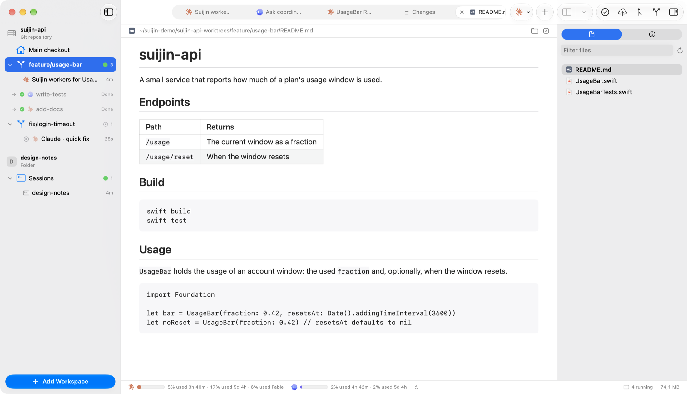

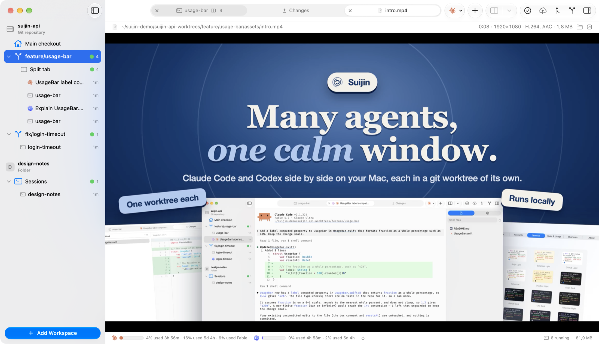

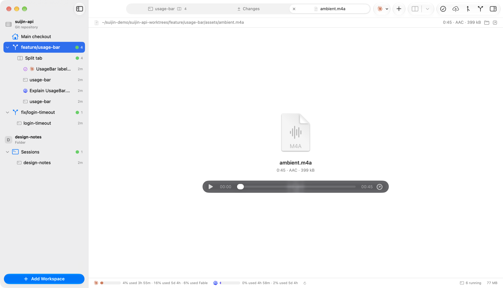

### Permission modes

Every agent session starts in a permission mode: Ask, Auto-Accept Edits, Plan or Skip All Permissions for Claude Code;
Ask, Auto, Read-Only or Skip All Permissions for Codex. Settings sets the default per agent, and the Permissions menu
picks one for a single session. A session that skips permission checks shows a warning badge, and starting one is
confirmed first.

### Multiple accounts

- Add several managed Claude and Codex accounts and choose which one a session uses.
- Your own logins stay untouched: Suijin never writes to `~/.claude`, `~/.claude.json`, `~/.codex` or the default
  Claude Code Keychain item. Managed accounts live under `~/Library/Application Support/Suijin`.
- The status bar shows each plan's usage.
- **Continue With Another Account** carries a conversation to another account when one runs out, in the same tab,
  folder and permission mode.
- Two options, both off by default, move sessions for you: when the default account changes, and when an account
  hits a usage limit (to the next account with room, in an order you set).
- Using several accounts, and switching between them at a usage limit, may be against the terms of Anthropic or
  OpenAI. Check them: you are responsible for how you use your accounts. Settings › Accounts says so as well.


### Agent orchestration

One agent can hand work to others. A coordinator agent in a Suijin terminal starts worker agents with the bundled
`suijin` command, each a Claude Code or Codex session of its own, in the same folder or in a new worktree.

```sh
suijin worker start --agent codex --name write-tests --spec "Add two tests for UsageBar"
suijin worker start --agent claude --worktree new --name add-docs --spec "Document UsageBar in the README"
```

- Every worker gets its own tab, and the sidebar lists the workers under their coordinator with a live status
  (Working, Asking, Done).
- A worker can ask its coordinator a question and gets the answer typed into its terminal.
- When a worker finishes, its result is delivered to the coordinator, which then reports the outcome of every task.
- Ask the coordinator to stop a worker (`suijin worker stop`) and that worker's tab closes. You can also close a
  worker from its row in the sidebar.
- The guide that teaches agents these commands ships with the app; you only ask for "Suijin workers" in plain words.

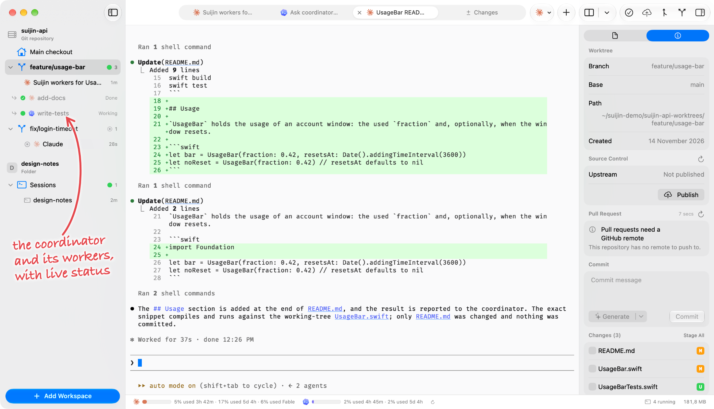

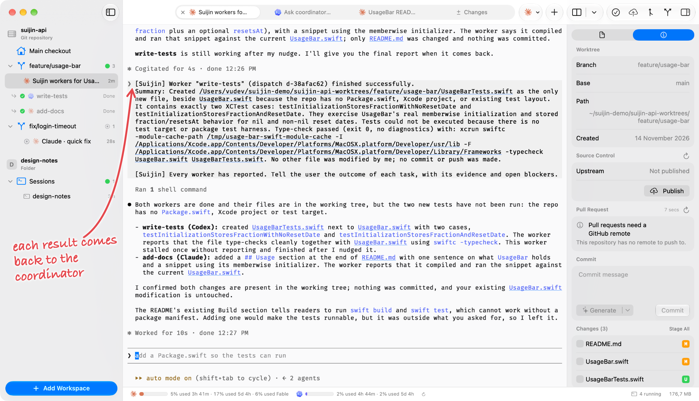

### Stats and usage

Settings › Stats & Usage shows tokens, estimated cost and activity per day, read from the local Claude Code and Codex
logs (read-only). Costs are estimates at API list prices, not your subscription bill. Clicking the session count in
the status bar opens the Resource Manager with the memory and CPU of running sessions.

### Light and dark

Suijin follows the system appearance or stays light or dark, and terminals with the Automatic theme switch along.

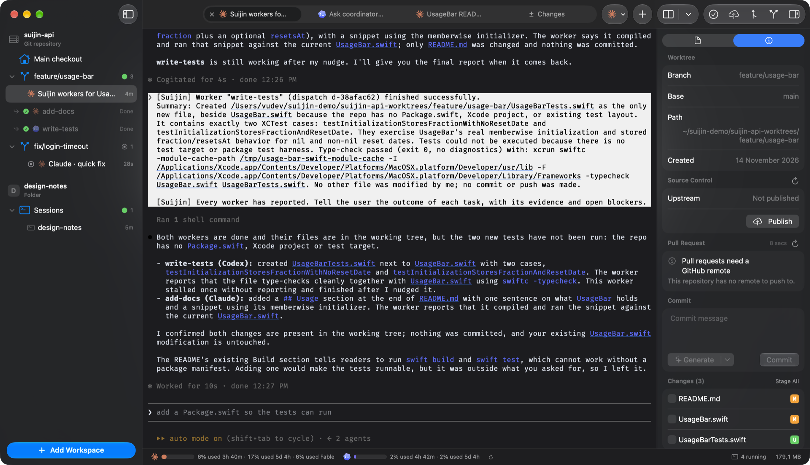

## Settings

Open Settings with ⌘,. It has seven pages.

| Page | What it controls |
|---|---|
| General | Appearance (Automatic, Light, Dark), notifications when an agent waits for input or finishes, keeping sessions running after quitting, system permissions (notifications, background helper, Full Disk Access), update checks, the welcome tour |
| Agents | Default agent, what a new pane runs, the folder for new worktrees, default permission mode per agent, where `claude` and `codex` were found, Codex daemon option, orchestration |
| Accounts | Managed Claude and Codex accounts, the default account per provider, automatic account switching |
| Terminal | Theme (15 built in, or Automatic to follow the appearance), font family and size, how file paths open |
| Stats & Usage | Token usage, estimated cost and activity for 7 days, 30 days or all time |
| Shortcuts | Every keyboard shortcut and mouse gesture, searchable by action or key (also Help › Keyboard Shortcuts, ⌘/) |
| About | Version, legal documents |

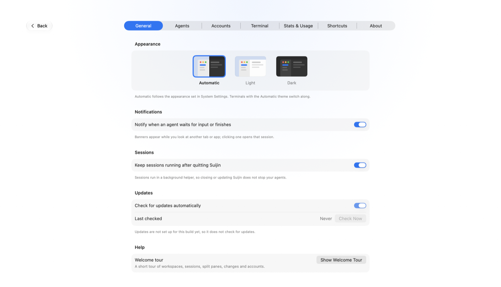

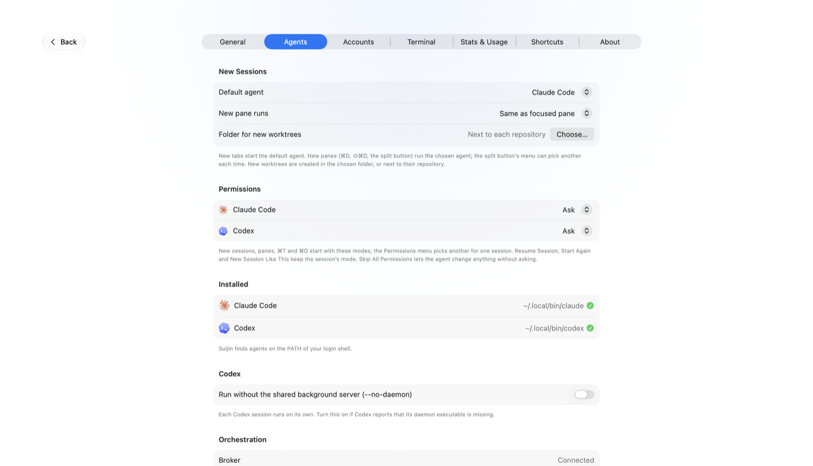


## First launch

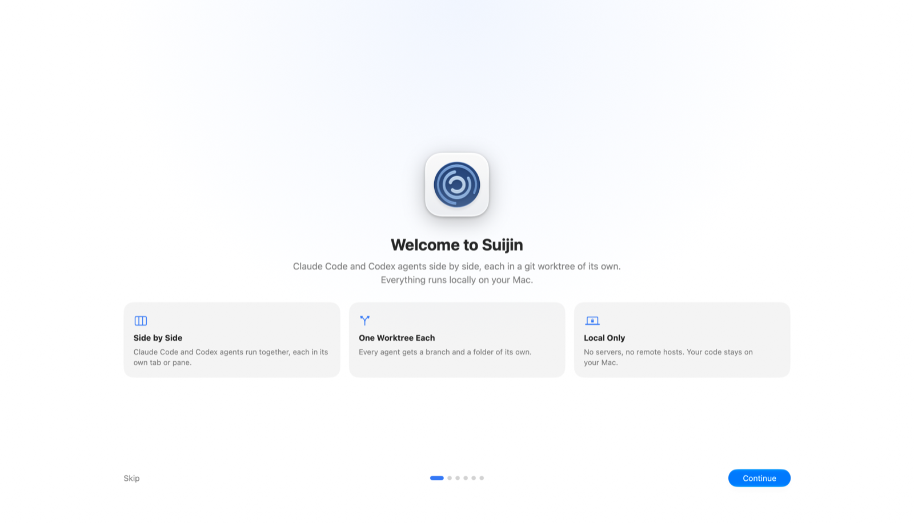

A short tour introduces workspaces, sessions, changes and accounts. It shows once and can be reopened from
Settings › General.

For the built-in agents, Suijin needs `claude` and/or `codex` installed and on the `PATH` of your login shell;
Settings › Agents shows what it found.

## Requirements

- macOS 15 or later. The Liquid Glass interface needs macOS 26 or later.
- To build: Xcode 27, `xcodegen` (`brew install xcodegen`) and the Metal Toolchain for SwiftTerm's renderer
  (`xcodebuild -downloadComponent metalToolchain`).

## Build from source

```sh
scripts/bootstrap.sh            # generate Suijin.xcodeproj from project.yml
scripts/ci-local.sh             # package tests + app build and tests
open Suijin.xcodeproj
```

The first time you build in Xcode, it stops with "Plugin “SwiftTermBuildInfoPlugin” from package “SwiftTerm” must be
enabled". Click the error and choose **Trust & Enable**. SwiftTerm ships this build-tool plugin, and Xcode asks once per
machine and again after a SwiftTerm upgrade. Command-line builds skip the prompt with `-skipPackagePluginValidation`.

## Documentation

- [`CLAUDE.md`](CLAUDE.md): repository rules for people and AI agents.
- [`docs/CONTRIBUTING.md`](docs/CONTRIBUTING.md): how to contribute: issue first, then a pull request for it.
- [`docs/architecture.md`](docs/architecture.md): package layout, processes, sessions, accounts and tests.
- [`docs/release-process.md`](docs/release-process.md): signing, notarization and Sparkle updates.
- [`CHANGELOG.md`](CHANGELOG.md): what changed.

## License

Suijin is licensed under the [Apache License 2.0](LICENSE). Copyright 2026 The Suijin Authors. The license covers the
code; it does not grant the use of the Suijin name or icon.
