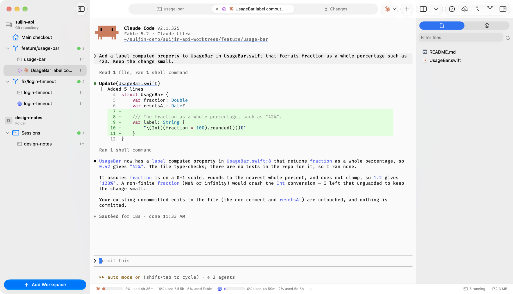
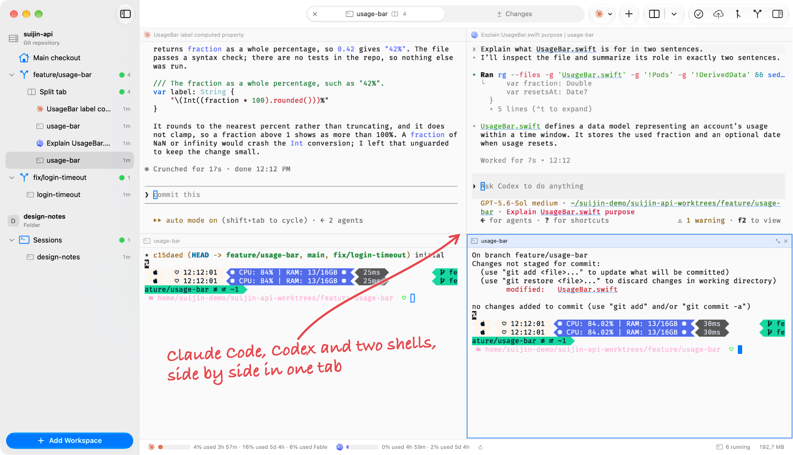
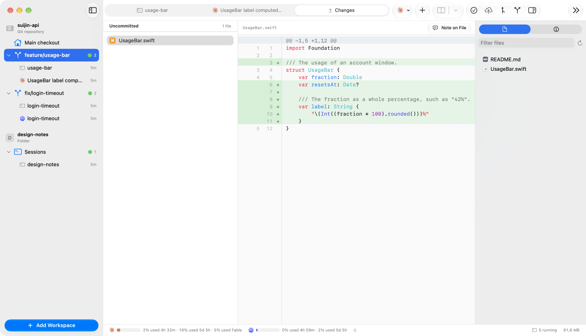
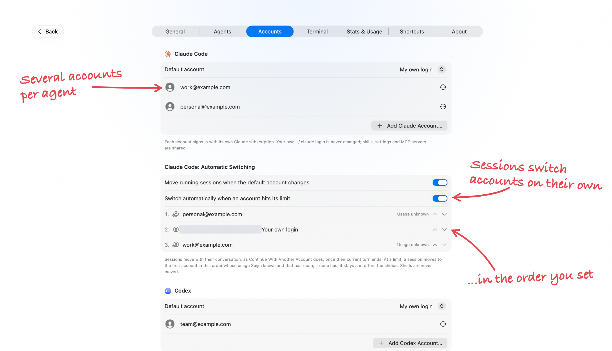
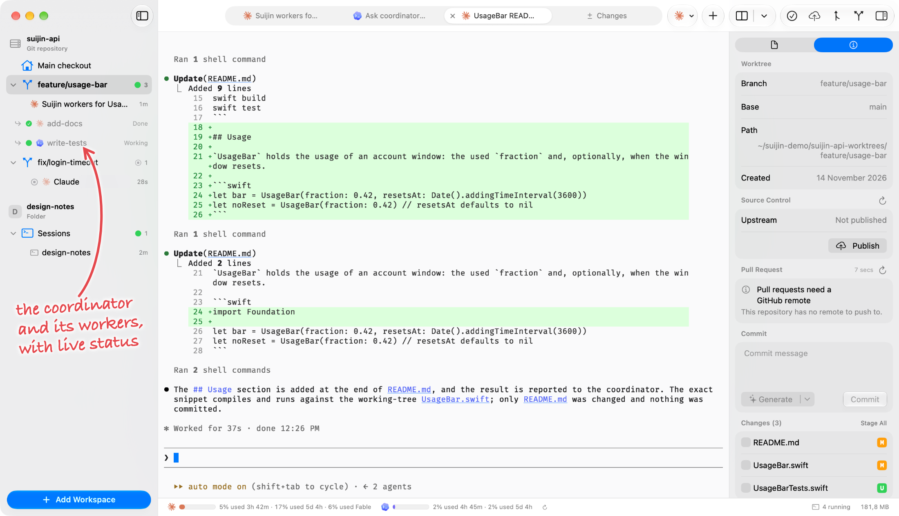

Suijin 0.1.0 is the first release: a native macOS app that runs Claude Code, Codex and any other command-line AI coding agent side by side, each in a git worktree of its own. Your code and your agents stay on your Mac.

## New

- **Workspaces and worktrees.** Add a git repository or a plain folder as a workspace (⇧⌘O). Each agent gets a worktree on a branch of its own (⌘N), so parallel changes never collide, and the sidebar shows every worktree with the status of the sessions running in it.

- **Tabs and split panes.** Start Claude Code, Codex or a shell in a tab, and run any other command-line agent in the shell. A tab splits into as many as ten panes (⌘D, ⇧⌘D); drag a pane by its header to rearrange it, or zoom the one you are reading (⇧⌘↩).

  

- **Sessions that keep running.** Sessions run in a background helper, so quitting or updating Suijin does not stop your agents. When an agent exits, its tab shows a Session Ended view with **Resume Session** and **Start Again**.

- **Changes and pull requests.** Review what an agent changed in a native diff viewer, leave notes on a file or a line and send them back to the agent, then commit, push and open the pull request from the same tab.

  

- **Files and media.** Code, rendered Markdown, images, video and audio open in a tab next to your sessions.

- **Permission modes.** Every Claude Code and Codex session starts in a permission mode: Ask, Auto-Accept Edits, Plan or Skip All Permissions for Claude Code; Ask, Auto, Read-Only or Skip All Permissions for Codex. Settings › Agents sets the default for each agent, and a session that skips permission checks is confirmed first and marked with a badge.

- **Multiple accounts.** Add several managed Claude and Codex accounts in Settings › Accounts without touching your own logins, and see each plan's usage in the status bar. **Continue With Another Account** carries a conversation to another account when one runs out. Automatic switching, off by default, moves a session to the next account with room when its account hits a limit.

  

- **Agent orchestration.** Ask an agent for "Suijin workers" and it starts other Claude Code or Codex agents with the bundled `suijin` command, each in a tab of its own, answers their questions and collects their results.

  

- **Stats and usage.** Settings › Stats & Usage shows tokens, estimated cost and activity per day from the local Claude Code and Codex logs. Costs are estimates at API list prices, not your subscription bill.

- **Settings.** Light, dark or automatic appearance, 15 terminal themes, a searchable list of every keyboard shortcut (⌘/), and a Permissions section in Settings › General that shows whether macOS allows notifications, the background helper and Full Disk Access, with a button to allow each. Full Disk Access is optional.

- **Private by design.** No account, no telemetry and no crash reports. Suijin goes online itself only to check for updates and to read usage limits with your own login.

## Installing and updating

Download `Suijin-0.1.0.dmg` below, open it and drag Suijin to Applications. Suijin is signed with a Developer ID and notarized by Apple.

Suijin checks for a new version about once a day and from Suijin › Check for Updates…; Settings › General turns the automatic check off. `suijin.app` counts those checks per day and app version, and keeps nothing else. This is the first release, so the first update you see will be the next version.

## Requirements

- macOS 15 or later. The Liquid Glass interface needs macOS 26 or later.
- For the built-in agents, Claude Code and/or Codex installed on your Mac; Settings › Agents shows what Suijin found.

Suijin is open source under the Apache License 2.0. Website: [suijin.app](https://suijin.app)
